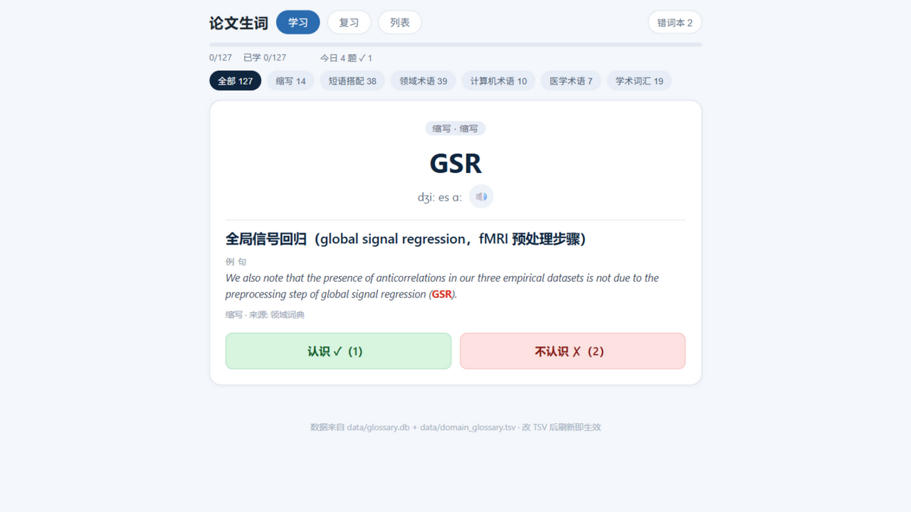
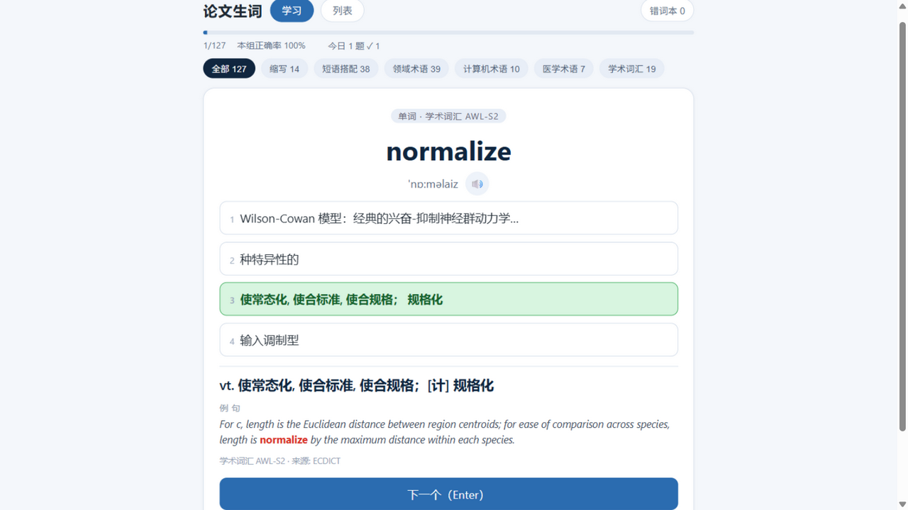
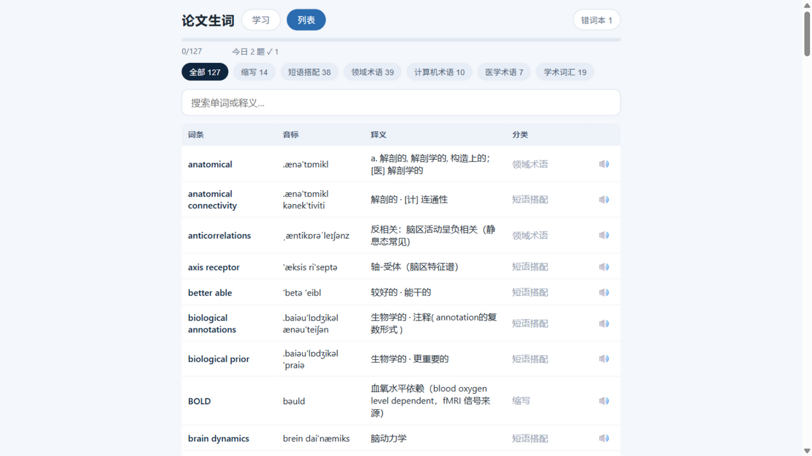

# PaperLex · 论文生词本

把正在读的英文论文 PDF 变成生词本：自动抽取领域术语与搭配，配国际音标和发音，
**学习 → 复习（SRS 间隔重复）** 两段式网页背单词，并可一键导出 Anki 卡包。

| 学习（先过一遍） | 复习（四选一 + SRS） | 列表 |
| --- | --- | --- |
|  |  |  |

## 为什么做它

市面上的背单词软件（Anki / 墨墨 / 不背单词 / Quizlet…）词库都是"考试词表"，
而读文献时真正卡住你的是**论文里的领域术语和搭配**——connectome、Kuramoto 振子、
resting-state……它们不在任何词表里，ECDICT 也常常查不到或给出错误领域的释义。

PaperLex 的思路：**从你自己的论文里长出你的生词本**。

## 功能

- 📄 **PDF → 生词**：词频档位 + 学术词表（AWL/NAWL/CSWL/MAWL）+ 词典三重打分；
  自动切掉参考文献、过滤引用作者名与期刊页眉套话；名词短语（2~3 gram）与缩写单独成类
- 🏷️ **领域词典**：`data/domain_glossary.tsv` 一行一个 `key<TAB>释义[<TAB>音标]`，
  ECDICT 缺的、译错的，自己补一行，导入/网页/复习/导出全部生效，无需动数据库
- 🔤 **国际音标全覆盖**：ECDICT 音标 → 复合词成分拼接 → 缩写字母名（`FC → ef siː`、
  `fMRI → ef em ɑː aɪ`）→ 领域词典精修，127 词实测 100% 覆盖
- 📖 **学习 → 复习两段式**：先整卡过一遍（认识/不认识，播种记忆计划），学完解锁四选一测验
- 🔁 **SRS 间隔重复**（SM-2 简化版）：到期优先、答对间隔 1天→6天→×难度系数、
  答错归零回插队列、错词本；隔天再开网页，到期词自动排进复习
- 📱 **PWA 可安装**：浏览器"安装"到手机/桌面当独立 App 用，断网可刷（发音按需缓存）
- 🔊 **edge-tts 发音**：并发合成 + 本地缓存复用
- 🎴 **一键导出 Anki**：四选一题型卡片（`.apkg`），与网页进度互补
- 💾 **术语库唯一真源**：同一术语跨论文复用释义；`fix` 人工精修并锁定

## 快速开始

```bash
pip install pymupdf edge-tts genanki
```

**准备词典资源**（一次性）：

1. [ECDICT](https://github.com/skywind3000/ECDICT) 下载 `ecdict.csv`
2. [lemmatization-lists](https://github.com/michmech/lemmatization-lists) 下载
   `lemmatization-en.txt`，改名为 `lemma.en.txt`
3. 学术词表已随仓库自带（`resources/wordlists/`）

放入 `resources/` 目录（或用环境变量指向任意位置：`setx PAPERLEX_RESOURCES "目录"`），
然后构建词典索引：

```bash
python -m src.build_dict
```

**导入论文、开始背**：

```bash
python main.py import 论文.pdf          # 也可以传目录，自动找所有 PDF
python main.py web                      # 网页版，浏览器自动打开
python main.py build                    # 导出 Anki 卡包 output/论文生词.apkg
```

网页版首次打开默认进入**学习**模式：整卡过一遍，点「认识 / 不认识」；
过完一遍后进入**复习**：到期词优先的四选一，答错的词自动回插队列并计入错词本。

## 命令一览

| 命令 | 作用 |
| --- | --- |
| `python main.py import 论文.pdf 或 目录` | 抽取术语入库 |
| `python main.py web [--host 0.0.0.0] [--port 8000]` | 网页版背单词 |
| `python main.py build [--kind word\|phrase\|abbr] [--category 前缀] [--limit n]` | 导出 Anki 卡包 |
| `python main.py stats` | 术语库概况 |
| `python main.py fix connectome "连接组：全脑神经连接的完整图谱"` | 人工精修释义并锁定 |
| `python main.py remove kringelbach --force` | 删除词条 |

## 工作原理

- **抽取**：pymupdf 取全文 → 去页眉/参考文献/引用人名 → 分词 + 词形还原 →
  词频 × 罕见度 × 学术标记打分 → 单词/短语/缩写按配额选出
- **释义优先级**：`fix`（锁定）> `domain_glossary.tsv` > ECDICT > 成分释义拼接
- **SRS**：SM-2 简化版，状态存浏览器 localStorage；
  `iₙ₊₁ = round(iₙ × ease)`，答对 1天→6天→按难度系数递增，答错间隔归零、ease −0.2

## Roadmap

- [ ] FSRS-6 调度（对齐 Anki 新算法）
- [ ] 拼写练习模式
- [ ] 论文跨词共现统计，自动发现高价值术语对

## 致谢

- [ECDICT](https://github.com/skywind3000/ECDICT)（MIT）—— 英文词典数据
- [lemmatization-lists](https://github.com/michmech/lemmatization-lists) —— 词形还原表
- [NGSL](https://www.wgtn.ac.nz/lals/resources/paul-nations-resources/paul-nations-resources/reading-vocabulary-files)（CC-BY-SA）、[AWL / NAWL](https://www.wgtn.ac.nz/lals/resources/academicwordlist/)、CSWL / MAWL —— 学术词表（`resources/wordlists/`，仅作学习用途）
- [edge-tts](https://github.com/rany2/edge-tts)、[genanki](https://github.com/kerrickstaley/genanki)、[pymupdf](https://github.com/pymupdf/pymupdf)
- 记忆算法思想来自 [Anki 的 SM-2](https://docs.ankiweb.net/background.html) 与 [open-spaced-repetition](https://github.com/open-spaced-repetition)

## License

[MIT](LICENSE)
